<!-- Agents working for a user: read AGENTS.md first, then skills/gameanything/SKILL.md. -->
**English** | [简体中文](README_zh.md)

<p align="center"></p>
<h2 align="center">GameAnything: From Any Inspirations to Playable Game Worlds</h2>
<p align="center"><b>Turn your memories and favourite stories into worlds you can play.</b></p>

<p align="center">
  
  
  
  
  
  
  
  <br>
  
  <a href="LICENSE"></a>
  <br>
  <a href="https://arxiv.org/abs/2611.29238"></a>
  <a href="https://huggingface.co/spaces/GameAnything/GameAnything"></a>
  <a href="https://github.com/AetherLabsAI/GameAnything-Bench"></a>
</p>

<p align="center">📊 Benchmark: <a href="https://github.com/AetherLabsAI/GameAnything-Bench">GameAnything-Bench</a></p>

<p align="center">
  <a href="https://huggingface.co/spaces/GameAnything/GameAnything">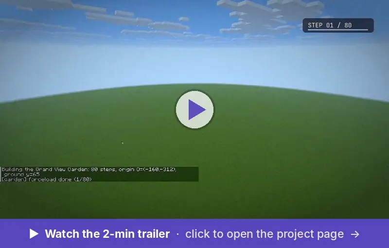</a>
  <br>
  <b>🎬 <a href="https://huggingface.co/spaces/GameAnything/GameAnything">Watch the full 2-minute trailer on the project page</a></b>
</p>

<!-- DEMO:G1 hero, 8-grid (4x2), 1600 px wide: Dream of the Red Chamber, Harry Potter, And Then There Were None (Minecraft) · San Diego (Cities: Skylines) · Hong Kong food (Overcooked! 2) · PhD (Slay the Spire) · a wedding (Stardew Valley) · a hot spring (Valheim) -->
<p align="center"></p>

Give your coding agent a folder of photos, a novel or a film, and say what you want. GameAnything turns it into a mod for a game
you already own: the places, the people, the story. You never write code. You talk to the agent in a local web page, pick from
the cards it shows you, watch the playtest video, and say what to change. The agent builds, plays and fixes it, round after round.

## From your album to your game

<!-- DEMO:G2a novel -> target picture -> game (Dream of the Red Chamber, same camera angle) -->
<table>
<tr><th width="33%">Your material</th><th width="67%">What it became in the game</th></tr>
<tr><td valign="top"><br>
<b>A novel.</b> One line from <i>Dream of the Red Chamber</i> becomes the Grand View Garden in Minecraft.</td><td valign="top"></td></tr>
<tr><td valign="top"><br>
<b>A real place.</b> San Diego, the city of a memory, rebuilt in Cities: Skylines.<br><sub>Balboa Park photo: Christian David, Wikimedia Commons, CC BY-SA 4.0</sub></td><td valign="top"></td></tr>
<tr><td valign="top"><br>
<b>A film.</b> <i>Harry Potter</i>: from film scenes to the same places in Minecraft.</td><td valign="top"></td></tr>
</table>

## How it works

Open your agent in a terminal and say one sentence, like the ones in the [examples](#examples). From then on everything happens in the browser.

<table><tr><td width="55%"></td><td>

1. **Drop in your material.** Photos, videos, a novel, a film. It stays on your computer.
2. **Pick what matters.** The agent shows the people, places and scenes it found as cards; you choose.
3. **Press Start.** It writes the mod, plays it and fixes it by itself.
4. **Watch and comment.** Every version comes with a playtest video; your notes shape the next one.
5. **Take it home.** Into your own game, with your saves backed up first.

</td></tr></table>

## Quick start

```bash
uv tool install git+https://github.com/AetherLabsAI/GameAnything    # 1. the gameanything command

# 2. add the skill to your agent, e.g. in Claude Code:
#      /plugin marketplace add AetherLabsAI/GameAnything
#      /plugin install gameanything@gameanything

gameanything ui                                                    # 3. open the web page
```

Then tell your agent what you want to make. Other agents, and what your computer needs (ffmpeg, your game's mod loader and build tools): [Install](#install).

## It builds, playtests and fixes itself

Builders do not stop when the code compiles. They play the game, compare the screenshots with the target pictures, write down
what is still wrong and fix it, for up to three rounds per version. A status table tracks each of your requests: done, partial,
not yet or broken. Things that worked before are checked again so they don't break.

<!-- DEMO:G4 round 1 vs round 3 (Hong Kong food before / round 1 / round 3; San Diego early vs later version) -->
**The same kitchen, round by round (Overcooked! 2)**

| BEFORE | ROUND 1 | ROUND 3 |
|:--:|:--:|:--:|
|  |  |  |

<!-- DEMO:G5 sped-up clip of the agent playtesting -->
**It builds itself, from empty land (sped up)**

| Dream of the Red Chamber · Minecraft | Hogwarts · Minecraft | And Then There Were None · Minecraft |
|:--:|:--:|:--:|
|  |  |  |

## It gets better with every round, and every project

Your notes don't scroll away. Each one becomes a record tied to the exact frame or spot you meant, and the next version is
re-shot at that same frame, so you can say *fixed* or *not yet*. What the agents learn is kept:

| 🗂️ Working state | 📚 Lessons | 💜 Your preferences |
|---|---|---|
| Every request with its state, evidence and who checked it. The builder and the playtester share it. | What worked and what broke, per game and per role. A lesson starts as a candidate and becomes a rule once it holds in another project. | What you keep asking for (*richer scenes, never plain*), on a page you can read and edit. Private to you. |

After each version a short retrospective turns your notes into lessons; before the next delivery a critic checks the build
against them: *would you say this again?* The goal is simple: the same note never twice.

## Watch it work

<table><tr><td width="42%"></td><td>A live card in the chat shows what the builder is doing right now (<i>compiling the mod</i>, <i>taking screenshots in the game</i>, <i>waiting for the game to start</i>), the round, the time used against the estimate, and the newest screenshots.<br><br>If something stalls or a usage limit is hit, you see it there. <b>Open the work view</b> for the timeline, and, once you agree, a live view-only picture of the game.</td></tr></table>

## Four modes

<table>
<tr><td width="50%" valign="top">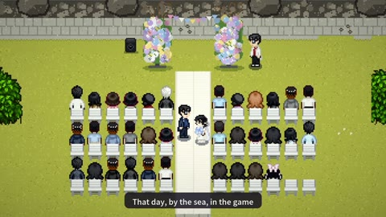<br><b>Memory</b><br>Your photos + your words → a world of that day<br><sub>A wedding · Stardew Valley</sub></td><td width="50%" valign="top">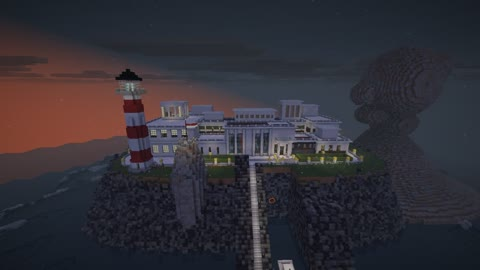<br><b>Adaptation</b><br>A novel or a film → its places and scenes, playable<br><sub><i>And Then There Were None</i> · Minecraft</sub></td></tr>
<tr><td width="50%" valign="top">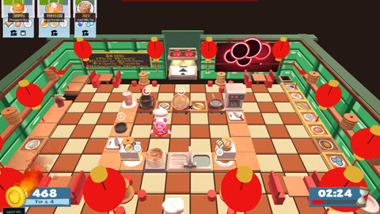<br><b>Feature</b><br>One idea → one new thing in your game: a dish, a tool, a mini game<br><sub>A Hong Kong cha chaan teng · Overcooked! 2</sub></td><td width="50%" valign="top">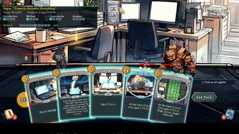<br><b>Gameplay</b><br>An experience → the game's own mechanics<br><sub><i>PhD: The Spire</i>: fight The Deadline and The Bug · Slay the Spire</sub></td></tr>
</table>

## Examples

Each example is a real project. *Open the demo* takes you into its real web page, read-only: the whole conversation, every card, the plan and the playtest videos.

<table>
<tr>
<td width="50%" valign="top" align="left">

<p align="center">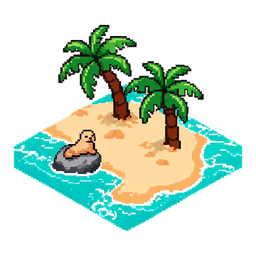</p>

**Memory · My San Diego photos → Cities: Skylines** · 7 versions<br>
Photos and memories → the city, rebuilt<br>
💬 *"Turn my **San Diego** years into a city."* 📎 your photo folder<br>
<a href="https://gameanything-gameanything-demo.static.hf.space/sd/">▶ Open the demo</a> · <a href="docs/examples/sd.md">Full conversation</a>

<details><summary>Read the conversation</summary>

🧑 **You:** *(uploads my photos)*

🤖 **Agent:** They group into a harbor with a carrier and a big statue, sea cliffs with sea lions, a park with domes and a long pool, and a mall at sunset. Where are these, and which matter most?

🧑 **You:** The harbor, La Jolla Cove, UTC and Balboa Park, plus a drive along the coast. I want a San Diego I can walk around in.

🃏 **Card — City layout** A: follow the real coastline · B: a small town → **A**. **Card — Exploring** → one "memory camera" per place.

🃏 **Card — Landmark models** → Workshop models where they exist; the agent generates the rest (statue, tower, sea lions).

🎬 **Versions 1–2** — real terrain and roads, five places, then blue water, 2,400 buildings and the first 3D models.

🧑 **You:** It's still grey and empty. Where are the sea lions? Balboa Park looks nothing like it.

🎬 **Version 3** — a walkthrough video, refined over four cuts.

🧑 **You** *(0:33)*: Where's the UTC landmark? *(0:55)* Where are the real stores? Find the real layout from above and photos of each store.

🤖 **Agent:** UTC is now rebuilt from its real map footprint, with storefronts made from real photos and a carrier deck with 30 aircraft.

🧑 **You** *(2:36)*: Is this clipping? The camera is still shaky.

🎬 **Version 3, final cut** — 3:18, chapters for the harbor, the cove, UTC, Balboa and the drive.

🧑 **You:** Now build the UCSD campus into this city, using real pictures.

🎬 **Versions 4–7** — Geisel Library, Price Center and Warren Mall: real positions and scale, Library Walk with banners and students, then checked against the map from above. Video 1:05.

</details>

</td>
<td width="50%" valign="top" align="left">

<p align="center">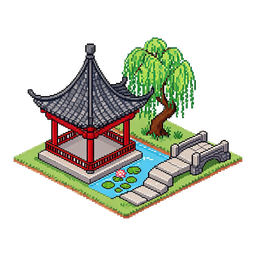</p>

**Adaptation · <i>Dream of the Red Chamber</i> → Minecraft** · 6 versions<br>
A novel → a garden you can walk in<br>
💬 *"Build the Grand View Garden from **Dream of the Red Chamber** in Minecraft."*<br>
<a href="https://gameanything-gameanything-demo.static.hf.space/hlm/">▶ Open the demo</a> · <a href="docs/examples/hlm.md">Full conversation</a>

<details><summary>Read the conversation</summary>

🧑 **You:** *(uploads Chapters 17 and 27 of the novel)*

🤖 **Agent:** 22 scenes, 23 places, 22 characters, 189 quotes checked against the public-domain text. The book says *what* is there, almost never how big or what the roof looks like. I'll invent that part or ask you.

🃏 **Card — 5 things the text doesn't say** → *"Grand and rich: a huge estate full of towers and pavilions. As realistic as possible: own mod, new blocks and models."*

🃏 **Card — What fills a grand garden?** A: invent it · B: add other chapters that describe the garden → **B** (Ch. 18, 40, later Ch. 3 and 8 for how the characters look)

🃏 **Card — Preview pictures, two per place** → I pick one for each of 10 places.

🎬 **Version 1** — the garden skeleton: 12 places, the river, 59 custom blocks, quote signs. Video 2:06.

🧑 **You** *(0:56)*: What is this supposed to be? It's far from the preview. *(1:15)* Every courtyard needs a plaque with its name.

🎬 **Version 2** — 9 more places, hills, layered trees, upturned grey roofs, plaques, flowing-water sound. Video 4:24.

🃏 **Card — How do characters and stories appear?** A: stand and talk · B: walk up and a short scene plays, with subtitles from the novel · C: play as Baoyu → **B**

🧑 **You** *(on the story art)*: Daiyu looks like she's hammering the flowers. → redrawn with a long-handled flower hoe.

🎬 **Versions 3–4** — 25 character models; all 25 story scenes placed where they happen in the book; a switchable Lantern Festival night. Video 7:53.

🧑 **You** *(7:26)*: Why are these people floating?

🎬 **Version 5** — an automatic check of all 25 scenes: nobody floats. Video 8:17.

🧑 **You** *(4:52)*: Why is there a pink block in the air? Daiyu holds her hoe backwards, and the grave is crude.

🎬 **Version 6** — polish only: a round mossy grave, the hoe the right way round, a richer main hall. Reviewer: 16 of 25 shots close to the preview. Video 8:09.

</details>

</td>
</tr>
<tr>
<td width="50%" valign="top" align="left">

<p align="center">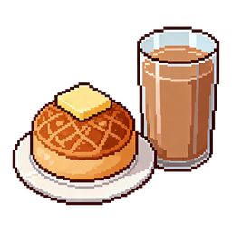</p>

**Feature · Hong Kong food → Overcooked! 2** · 4 versions<br>
One idea → a new kitchen and real dishes<br>
💬 *"Open a **Hong Kong cha chaan teng** in Overcooked."*<br>
<a href="https://gameanything-gameanything-demo.static.hf.space/hk/">▶ Open the demo</a> · <a href="docs/examples/hk.md">Full conversation</a>

<details><summary>Read the conversation</summary>

🧑 **You:** *(uploads my food photos)* Pick the classic Hong Kong dishes the game doesn't have, build a Hong Kong map, and add two local chefs.

🤖 **Agent:** I see har gow, cheung fun, pineapple buns, claypot rice, an egg sandwich, mango pomelo sago… The cartoon pig you like is copyrighted, so we'll make an original pink piglet chef and a generic kung-fu chef.

🃏 **Card — Chefs and map** → kung-fu chef + piglet chef, a cha chaan teng (diner) interior. Menu: 7 dishes.

🎬 **Version 1** — the diner with four rush phases. Honest note: the cooking still uses the game's old recipes. Video 2:10.

🧑 **You:** It feels like you just put new pictures on the old dishes. Why is claypot rice a steamed fish? Why is the pineapple bun a steamed carrot?

🤖 **Agent:** You're right. Version 2 cooks each dish the real way, with its own steps and ingredients.

🧑 **You:** The pineapple bun needs an oven!

🎬 **Version 2** — all 8 dishes cooked the real way (the bun goes blender → tin → a borrowed oven), plus a green-tiled diner with red lanterns. Video 2:54.

🧑 **You:** Make the dishes 3D, with previews first. Bilingual text. Start the video at the very beginning.

🃏 **Card — 7 3D dishes: keep / redo / drop** → *"Is this even from above???"* *"The ice cubes look ugly."* Two redos later: keep all.

🎬 **Version 3** — 3D dishes on the plates, bilingual menu, a new-level title. Video 9:41.

🧑 **You** *(0:52)*: What's this pink thing? *(4:06)* Why is the pan empty after frying the egg?

🎬 **Version 4** — normal bread colour, a visible egg in the pan, plating moved out from behind the timer. Video 10:11.

</details>

</td>
<td width="50%" valign="top" align="left">

<p align="center"></p>

**Gameplay · Doing a PhD → Slay the Spire** · 4 versions<br>
An experience → the game's own mechanics<br>
💬 *"Make a **surviving the PhD** character for Slay the Spire."*<br>
<a href="https://gameanything-gameanything-demo.static.hf.space/phd/">▶ Open the demo</a> · <a href="docs/examples/phd.md">Full conversation</a>

<details><summary>Read the conversation</summary>

🧑 **You:** *(uploads my design notes about PhD life)*

🤖 **Agent:** The core tension: long investment versus uncertain feedback. Failed experiments still build understanding, but value only pays out after idea → experiment → evidence → writing → submission.

🃏 **Card — 6 questions** → the hardest moments: rejections, no progress, a low-scoring AI reviewer. Inside jokes: Reviewer 2, getting scooped on arXiv, running out of tokens.

🃏 **Card — Mechanics page** → 23 experience → mechanic rows kept (a failed experiment gives Insight; *Rejected* keeps half your progress; enemies are things like Bug and Scope Creep, never people).

🎬 **Version 1** — *The Researcher*: 33 cards, 10 relics, 6 enemies, boss *The Deadline*, a "You graduated!" ending. Video 3:48.

🧑 **You:** This video is just cards being played. No story, no strategy. Watch it yourself.

🎬 **Narrated video** — slower, a caption for each key decision, chapters from finding a problem to graduation. Video 3:20.

🧑 **You:** Honestly, the design itself is boring.

🃏 **Card — What feels most boring?** → doesn't feel like a PhD, enemies have no character, cards all alike. **Direction:** real dilemmas + memorable moments.

🃏 **Card — Version 2 change list (from my notes)** → a run is one submission: deadline → *Under Review* → three reviewer scores → 3 turns of rebuttal → Accept / Reject & Resubmit / Desk Reject.

🎬 **Version 2** — the full submission flow; 41% of simulated runs get accepted. Video 3:52.

🧑 **You:** NeurIPS uses a 6-point scale. Your scores are wrong.

🎬 **Versions 3–4** — the 6-point scale, bigger cards, hit and Stress feedback with sounds, then English captions and layout fixes. Video 3:55.

</details>

</td>
</tr>
</table>

## Install

**Prerequisites**

| What | Notes |
|---|---|
| **Python 3.10-3.14** and **[uv](https://docs.astral.sh/uv/)** | runs the `gameanything` command |
| **ffmpeg** / **ffprobe** on PATH | video frames, playtest recordings |
| **a coding agent** | any one from the table below |
| **your own copy of the game** | GameAnything never ships or downloads games |
| **the game's mod loader** | SMAPI · Fabric · BepInEx · ModTheSpire + BaseMod · tModLoader; the other games load mods themselves. `gameanything native doctor` checks it and says what to install |
| **the game's build tools** | .NET SDK 6 / 8 (Stardew Valley, Cities: Skylines, Overcooked! 2, Valheim, KSP, Terraria) · Java 21 / 11 (Minecraft, Slay the Spire) · Python 3.7 (The Sims 4) · nothing (Civilization VI) |

Builds run either **natively** in your own copy of the game on Windows / macOS / Linux, or in a **sandbox**: a Docker container on your own Linux computer or server (NVIDIA GPU for 3D games) with the mod loader, the build tools and a screen you watch in the browser. You bring the game: your own game folder, or a download with your own Steam / EA / Microsoft account inside the sandbox. So the build-tool and loader rows above are for native mode only. Setup: [docs/install.md](docs/install.md#sandbox-on-your-own-linux-machine-docker) · the images: [docs/sandbox-images.md](docs/sandbox-images.md).

**Two optional features** are left out of the basic install because they are large. You don't need to set them up in advance:
when your files need one, the agent asks you on a card (what it is for, how big) and installs it only if you agree.

| Feature | What it does | Without it | Size |
|---|---|---|---|
| **Speech to text** (`transcribe`) | turns what people say in your videos into text, on your computer | videos are added, but what is said in them stays unknown | ~150 MB + a 1.6 GB speech model on first use |
| **Find people in photos** (`detect`) | boxes each person on the people page, on your computer (no face recognition) | you draw the boxes yourself | a few hundred MB to 2 GB+ |

To install one yourself: `gameanything extras status` shows what is missing and the exact command.

**1. The `gameanything` command line** (every agent needs it):

```bash
uv tool install git+https://github.com/AetherLabsAI/GameAnything
```

**2. The agent side** (the `gameanything` skill and instructions):

| Agent | Install |
|---|---|
| Claude Code | `/plugin marketplace add AetherLabsAI/GameAnything` then `/plugin install gameanything@gameanything` |
| Codex | `codex plugin marketplace add AetherLabsAI/GameAnything` then `codex plugin add gameanything@gameanything` |
| Gemini CLI | `gemini extensions install https://github.com/AetherLabsAI/GameAnything` |
| VS Code / Copilot | enable `chat.plugins.enabled`, run **Chat: Install Plugin From Source**, enter this repo's URL |
| Cursor | Cursor Marketplace → Import from Repo, or open a clone |
| OpenCode | clone the repo and run `opencode` inside it ([plugin](plugins/opencode/README.md)) |
| DeepSeek Harness (`dsh`) | clone the repo, start `dsh web` and add the clone with **Add workspace** (it reads `AGENTS.md` and `.agents/skills`); as the background agent: [setup](docs/agent-providers.md#deepseek-harness-setup) |
| Any agent (skills only) | `npx skills add https://github.com/AetherLabsAI/GameAnything` |

**3. Start:**

```bash
gameanything ui        # opens the local web page
```

Then tell your agent what you want to make (see the [examples](#examples)).

More: optional extras, using an API key only, running inside a clone, and the command line without an agent: [docs/install.md](docs/install.md).

**The `gameanything` CLI** (Python). Every command has `--help` with examples.

<!-- fixed widths and no-break spaces keep the icons from shrinking in an auto-width table -->
<table>
  <thead><tr><th width="56">&nbsp;&nbsp;&nbsp;&nbsp;&nbsp;&nbsp;&nbsp;&nbsp;</th><th width="110">Command</th><th>What it does</th></tr></thead>
  <tbody>
    <tr><td align="center">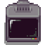</td><td><code>ui</code></td><td>Open the web page: your projects, the chat, the cards, the playtest videos</td></tr>
    <tr><td align="center">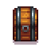</td><td><code>project</code></td><td>New project, list, settings, chat / build model, export and import</td></tr>
    <tr><td align="center">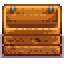</td><td><code>ingest</code></td><td>Sort and normalise your photos, videos and texts on your computer, no model</td></tr>
    <tr><td align="center">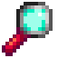</td><td><code>perceive</code></td><td>Look at your material with a model, only after your yes on a card</td></tr>
    <tr><td align="center"></td><td><code>flow</code></td><td>Which step the project is on and exactly what that step needs</td></tr>
    <tr><td align="center"></td><td><code>chat</code></td><td>How the agent talks to you in the page: text, cards, progress</td></tr>
    <tr><td align="center"></td><td><code>estimate</code></td><td>Time and cost of a build, shown before you press Start</td></tr>
    <tr><td align="center">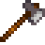</td><td><code>build</code></td><td>Background builds: status, delivery check, hand a build back</td></tr>
    <tr><td align="center">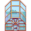</td><td><code>lab</code></td><td>The Linux server sandbox: take a seat, set up its environment, sign in to your own Steam / Microsoft / EA account inside it</td></tr>
    <tr><td align="center">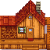</td><td><code>native</code></td><td>Your own copy of the game: check, back up, install, launch, restore</td></tr>
    <tr><td align="center">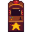</td><td><code>game</code></td><td>The supported games; scaffold and validate a new one</td></tr>
    <tr><td align="center">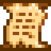</td><td><code>feedback</code></td><td>Your notes as records, checked again at the same frame</td></tr>
    <tr><td align="center"></td><td><code>profile</code></td><td>Your preferences, private to you: see, edit, switch off</td></tr>
    <tr><td align="center">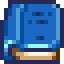</td><td><code>lessons</code></td><td>What the agents learned per game and role</td></tr>
    <tr><td align="center"></td><td><code>gen</code></td><td>Paid preview pictures and 3D models, only after your cards</td></tr>
    <tr><td align="center"></td><td><code>backup</code></td><td>Optional backup to a folder or a private Hugging Face dataset</td></tr>
    <tr><td align="center">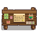</td><td><code>hub</code></td><td>One server for several people, each with their own projects</td></tr>
  </tbody>
</table>

## Accounts & cost

| Agent | Account | In GameAnything |
|---|---|---|
| **Claude Code** | Claude subscription or Anthropic API key | chat and background builds (the most tested) |
| **Codex** | ChatGPT subscription or OpenAI API key | chat and background builds |
| **Gemini CLI** | Google account or Gemini API key | chat and background builds |
| **OpenCode** | any of 75+ model providers: OpenRouter, Anthropic, OpenAI, local models… | chat and background builds |
| **DeepSeek Harness** (`dsh`) | DeepSeek or OpenRouter API key | chat; builds wired, not yet tested ([setup](docs/agent-providers.md#deepseek-harness-setup)) |
| **Cursor**, **GitHub Copilot** | your editor's plan | the same skill, used interactively |

API keys are billed per token.

- **Pick the model per project** next to the chat box (*Chat* / *Build*). Fable is the strongest and by far the most expensive.
- **Nothing is spent before you agree:** the go card shows the build model, time and cost; paid pictures and 3D models need their own card.

**Pictures, 3D models and sound (optional).** The agent can generate assets the game doesn't have. Each service needs its own key
(set it on the web page or as an environment variable), and every paid call waits for your yes on a card that shows the price.
Without them, builds use the game's own assets.

| Service | Key | Used for |
|---|---|---|
| **OpenRouter** (Seedream) | `OPENROUTER_API_KEY` | preview and target pictures, portraits, icons |
| **Meshy** | `MESHY_API_KEY` | 3D models: landmarks, props, characters |
| **fal** | `FAL_KEY` | pictures, 3D, sound effects, music, voices, video |
| **OpenAI** | `OPENAI_API_KEY` | pictures (gpt-image) |

## Supported games

<table>
  <thead><tr><th></th><th>Game</th><th>Mod loader</th><th align="center">Linux</th><th align="center">macOS</th><th align="center">Windows</th><th align="center">Linux server sandbox</th></tr></thead>
  <tbody>
    <tr><td></td><td><b>Stardew Valley</b></td><td>SMAPI</td><td align="center">✅</td><td align="center">✅</td><td align="center">✅</td><td align="center">✅</td></tr>
    <tr><td>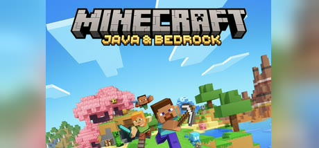</td><td><b>Minecraft</b></td><td>Fabric</td><td align="center">✅</td><td align="center">✅</td><td align="center">✅</td><td align="center">✅</td></tr>
    <tr><td></td><td><b>Cities: Skylines</b></td><td>built-in</td><td align="center">✅</td><td align="center">✅</td><td align="center">✅</td><td align="center">✅</td></tr>
    <tr><td></td><td><b>Slay the Spire</b></td><td>ModTheSpire + BaseMod</td><td align="center">✅</td><td align="center">✅</td><td align="center">✅</td><td align="center">✅</td></tr>
    <tr><td></td><td><b>Overcooked! 2</b></td><td>BepInEx 5</td><td align="center">✅</td><td align="center">✅</td><td align="center">✅</td><td align="center">✅</td></tr>
    <tr><td></td><td><b>The Sims 4</b></td><td>built-in</td><td align="center">✅</td><td align="center">✅</td><td align="center">✅</td><td align="center">✅</td></tr>
    <tr><td></td><td><b>Valheim</b></td><td>BepInEx 5</td><td align="center">✅</td><td align="center">✅</td><td align="center">✅</td><td align="center">✅</td></tr>
    <tr><td></td><td><b>Kerbal Space Program</b></td><td>built-in</td><td align="center">✅</td><td align="center">✅</td><td align="center">✅</td><td align="center">✅</td></tr>
    <tr><td></td><td><b>Terraria</b></td><td>tModLoader</td><td align="center">✅</td><td align="center">✅</td><td align="center">✅</td><td align="center">✅</td></tr>
    <tr><td></td><td><b>Civilization VI</b></td><td>built-in</td><td align="center">✅</td><td align="center">✅</td><td align="center">✅</td><td align="center">✅</td></tr>
    <tr><td align="center">➕</td><td colspan="6"><b>More games on the way.</b> We're integrating more games. Missing your favourite? <a href="#add-your-own-game">Add it with a pull request</a>: contributions are very welcome.</td></tr>
  </tbody>
</table>

Per-game notes (folders, loaders, what was tested where): [docs/games.md](docs/games.md). Native and sandbox builds: [Install](#install).

## Add your own game

Your favourite game isn't on the list? Every game is a small package: a `game.yaml`, an optional adapter and a smoke mod.

```bash
gameanything game new <id> --title "..." --loader ...
gameanything game check <id> --build
```

Guide: [add-a-game](skills/gameanything/references/add-a-game.md) · pull requests: [CONTRIBUTING.md](CONTRIBUTING.md#adding-a-game).
Agents also keep a lessons file per game (what worked, what broke). <!-- TODO: sharing lessons through PRs, when that exists -->

## Privacy & safety

<table><tr><td><ul><li><b>Local first.</b> Your files are only read, never changed, and projects live in your own data folder.</li><li><b>Nothing is sent without asking.</b> Before any photo or text goes to a model, you get a permission card. Every request that sent your content anywhere is written to the project's privacy ledger.</li><li><b>No made-up facts about real people.</b> Lines the agent drafts for real people are marked as drafts until you confirm them.</li><li><b>Your saves are safe.</b> Saves and mod folders are backed up before anything changes, and every install can be restored and uninstalled.</li><li><b>Sandboxed builds.</b> Sandbox builds run in an isolated Docker container. In native mode the agent asks before it starts your game and only closes the game it started.</li></ul></td><td width="34%"></td></tr></table>

## Benchmark

[GameAnything-Bench](https://github.com/AetherLabsAI/GameAnything-Bench) is the benchmark from the same paper: 125 Construction and 80 Editing tasks on 14 games. Project page: [huggingface.co/spaces/GameAnything/GameAnything](https://huggingface.co/spaces/GameAnything/GameAnything).

## FAQ

**Do I need to know how to code?** No. You talk and click. The agent writes the code.

**Does it come with the games?** No. You need your own copy. GameAnything only adds a mod to it.

**Which agent should I use?** Whichever you already have: Claude Code, Codex, Gemini CLI and OpenCode all chat and build in the background (Claude Code is the most tested); DeepSeek Harness chats, its builds are not yet tested; Cursor and Copilot work interactively. Each project picks its own *Chat* and *Build* model next to the chat box.

## 🤝 Contributing

GameAnything is an open project, and we warmly welcome contributions from players, game designers, modders and researchers. There are two ways to join:

| | [**Try GameAnything**](https://huggingface.co/spaces/GameAnything/GameAnything-Trial) | [**Contribute Tasks**](https://huggingface.co/spaces/GameAnything/gameanything-submit) |
|---|---|---|
| **For** | anyone who wants to use the platform | anyone with a game idea and a reference for it |
| **You share** | the games you play, the mods you have made, and one idea you would like to build (about 3 minutes) | a reference, a target game, a request and scoring points (about 10 minutes, no coding) |
| **You get** | free trial access, if selected | credit in the paper: thanks by name for 5 accepted tasks, authorship for a complete game package plus 10 accepted tasks |

Accepted tasks join the released benchmark under CC BY 4.0, with the name you choose. The submission page shows complete examples, and the paper's *Call for Contributions* appendix lists the standards.

Code is welcome too: new agents, games and fixes, as pull requests to [GameAnything](https://github.com/AetherLabsAI/GameAnything) or [GameAnything-Bench](https://github.com/AetherLabsAI/GameAnything-Bench). For questions, open an issue or email [wew058@ucsd.edu](mailto:wew058@ucsd.edu).

## Citation

If you use GameAnything, please cite our [paper](https://arxiv.org/abs/2611.29238):

```bibtex
@misc{wu2026gameanything,
  title  = {GameAnything: From Any Inspirations to Playable Game Worlds},
  author = {Wenyi Wu and Siqi Liu and Yuru Feng and Zixuan Song and Aayush Salvi and
            Sibo Zhu and Kun Zhou and Biwei Huang},
  year   = {2026},
  eprint = {2611.29238},
  archivePrefix = {arXiv},
  primaryClass  = {cs.AI},
  url    = {https://arxiv.org/abs/2611.29238}
}
```

## License

Licensed under the [Apache License 2.0](LICENSE).

The command icons are sprites from Stardew Valley © ConcernedApe, used for illustration only and not covered by the Apache-2.0 license ([details](docs/media/icons/cli/NOTICE.md)).

**Trademarks and your own mods.** GameAnything is not affiliated with or endorsed by the makers of any game listed here. Game names,
logos and header images belong to their owners. The examples use well-known books and films to show what is possible: a mod built from
someone else's work is for your own personal use. Don't share or sell it without the rights holder's permission.
