<!-- 替用户干活的 agent：先读 AGENTS.md，再读 skills/gameanything/SKILL.md。-->
[English](README.md) | **简体中文**

<p align="center"></p>
<h2 align="center">GameAnything: From Any Inspirations to Playable Game Worlds</h2>
<p align="center"><b>把你的回忆和喜欢的故事，变成能玩的游戏世界。</b></p>

<p align="center">
  
  
  
  
  
  
  
  <br>
  
  <a href="LICENSE"></a>
  <br>
  <a href="https://arxiv.org/abs/2611.29238"></a>
  <a href="https://huggingface.co/spaces/GameAnything/GameAnything"></a>
  <a href="https://github.com/AetherLabsAI/GameAnything-Bench"></a>
</p>

<p align="center">📊 评测基准：<a href="https://github.com/AetherLabsAI/GameAnything-Bench">GameAnything-Bench</a></p>

<p align="center">
  <a href="https://huggingface.co/spaces/GameAnything/GameAnything">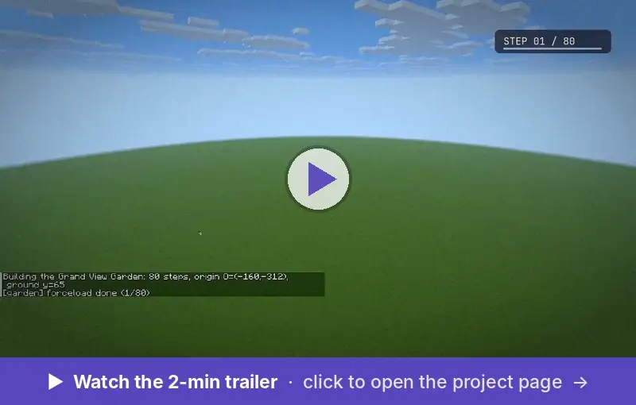</a>
  <br>
  <b>🎬 <a href="https://huggingface.co/spaces/GameAnything/GameAnything">在项目主页观看 2 分钟完整预告片</a></b>
</p>

<!-- DEMO:G1 八宫格 4×2，宽 1600 px：红楼梦、哈利波特、无人生还（Minecraft）· 圣地亚哥（城市：天际线）· 香港美食（胡闹厨房 2）· 读博（杀戮尖塔）· 婚礼（星露谷）· 雪中温泉（英灵神殿） -->
<p align="center"></p>

把一个文件夹的照片、一本小说或一部电影交给你的编程 agent，说你想做什么。GameAnything 会把它做成你已有游戏里的一个 mod：地方、人物、故事都在里面。
你不用写代码：在本地网页上和 agent 聊天，点选它发来的卡片，看试玩录像，说哪里要改。agent 自己构建、自己试玩、自己修，一版比一版好。

## 从相册到游戏

<!-- DEMO:G2a 小说原文 → 目标图 → 游戏（红楼梦，同一角度） -->
<table>
<tr><th width="33%">你的素材</th><th width="67%">它在游戏里变成了什么</th></tr>
<tr><td valign="top"><br>
<b>一本小说</b>：《红楼梦》里的一句话，变成 Minecraft 里的大观园。</td><td valign="top"></td></tr>
<tr><td valign="top"><br>
<b>一个真实的地方</b>：圣地亚哥，一段回忆里的城市，在《城市：天际线》里重建。<br><sub>Balboa Park 照片：Christian David，Wikimedia Commons，CC BY-SA 4.0</sub></td><td valign="top"></td></tr>
<tr><td valign="top"><br>
<b>一部电影</b>：《哈利波特》，从电影画面到 Minecraft 里同样的地方。</td><td valign="top"></td></tr>
</table>

## 怎么运作

在终端里打开你的 agent，说一句话就行（像[例子](#例子)里那样），之后的事都在网页上完成。

<table><tr><td width="55%"></td><td>

1. **放进素材**：照片、视频、小说、电影都行，文件一直留在你的电脑上。
2. **挑出重要的**：agent 把找到的人物、地点、场景做成卡片，你来挑。
3. **点开工**：它自己写 mod、自己试玩、自己修。
4. **看录像、提意见**：每一版都有试玩录像，你的意见会改进下一版。
5. **带回家**：装进你自己的游戏，装之前先备份存档。

</td></tr></table>

## 快速开始

```bash
uv tool install git+https://github.com/AetherLabsAI/GameAnything    # 1. 装 gameanything 命令

# 2. 给你的 agent 装上 skill，比如在 Claude Code 里：
#      /plugin marketplace add AetherLabsAI/GameAnything
#      /plugin install gameanything@gameanything

gameanything ui                                                    # 3. 打开网页
```

然后告诉你的 agent 想做什么。其他 agent 怎么装、电脑上要准备什么（ffmpeg、游戏的 mod 加载器和构建工具）：见[安装](#安装)。

## 自己构建、自己试玩、自己修

代码编译通过不算完。构建 agent 会进游戏试玩，把截图和目标图对比，记下还不对的地方再修，每一版最多三轮。
你的每一条要求都有进度表记着：做到了、只做了一部分、还没做，还是做坏了。以前做好的地方每一版都会重新检查，防止被改坏。

<!-- DEMO:G4 第 1 轮 vs 第 3 轮（香港美食 BEFORE / 第 1 轮 / 第 3 轮；圣地亚哥早期版 vs 后期版） -->
**同一间厨房，一轮一轮改（胡闹厨房 2）**

| BEFORE | ROUND 1 | ROUND 3 |
|:--:|:--:|:--:|
|  |  |  |

<!-- DEMO:G5 agent 试玩加速镜头 -->
**从一片空地自己建起来（加速）**

| 《红楼梦》· Minecraft | 《哈利波特》· Minecraft | 《无人生还》· Minecraft |
|:--:|:--:|:--:|
|  |  |  |

## 一轮比一轮好，一个项目比一个项目好

你的意见不会被聊天记录冲走。每一条都会记下来，并定位到你说的那一帧、那个地方；下一版在同一个画面重拍，你直接说「修好了」或者「还没有」。agent 学到的东西也会留下来：

| 🗂️ 工作状态 | 📚 经验本 | 💜 你的偏好 |
|---|---|---|
| 你的每条要求、做到没有、证据、谁查过。构建 agent 和试玩 agent 共用这一份。 | 每个游戏、每个角色，哪些做法管用、哪里踩过坑。新经验先当候选，在另一个项目里也验证过才成为规则。 | 你反复在意的事（比如「场景要丰富，不要简陋」），放在一个你能看、能改的页面上，只属于你。 |

每一版做完，会有一次简短的复盘，把你的意见变成经验；下一版交付前，再由一个「挑刺」的 agent 对照这些经验检查一遍：你会不会又说同样的话？目标很简单：同样的意见，不用说第二遍。

## 实时看它干活

<table><tr><td width="42%"></td><td>聊天里有一张实时卡片：构建 agent 现在在做什么（「在编译 mod」「在游戏里截图」「在等游戏启动」）、第几轮、用时和预计时间的对比、最新的截图。<br><br>卡住了或者用量到上限了，卡片上都会显示。点「看工作台」能看到时间线和进度；你同意后，还能看游戏的实时画面（只能看，不能操作）。</td></tr></table>

## 四种模式

<table>
<tr><td width="50%" valign="top">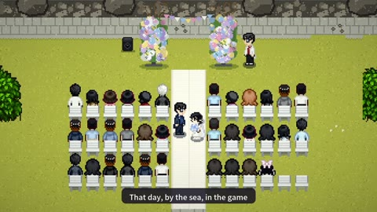<br><b>回忆</b><br>你的照片 + 你的话 → 那一天的世界<br><sub>一场婚礼 · 星露谷物语</sub></td><td width="50%" valign="top">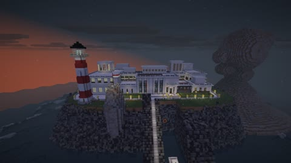<br><b>改编</b><br>一本小说或一部电影 → 能走进去的场景<br><sub>《无人生还》 · Minecraft</sub></td></tr>
<tr><td width="50%" valign="top">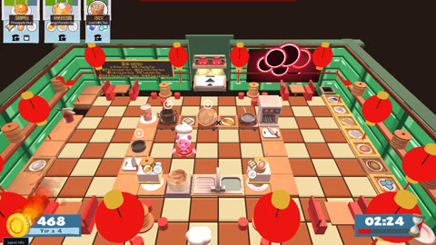<br><b>新功能</b><br>一个想法 → 游戏里多一样东西：一道菜、一个工具、一个小游戏<br><sub>港式茶餐厅 · 胡闹厨房 2</sub></td><td width="50%" valign="top">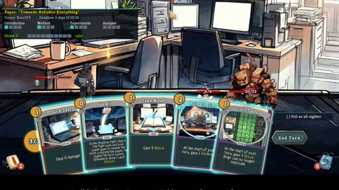<br><b>玩法</b><br>一段经历 → 游戏自己的机制<br><sub>「读博通关」：对手是 Deadline 和 Bug · 杀戮尖塔</sub></td></tr>
</table>

## 例子

每个例子都是一个真实项目：点「打开演示」能进入当时的真实界面（只读），看完整对话、每张卡片、方案和试玩录像。

<table>
<tr>
<td width="50%" valign="top" align="left">

<p align="center">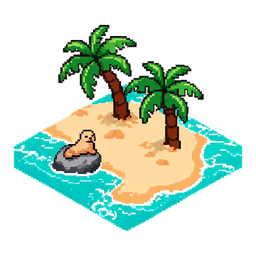</p>

**回忆 · 我的圣地亚哥照片 → 城市：天际线** · 7 版<br>
照片和回忆 → 重建的城市<br>
💬 *「把我在**圣地亚哥**的那几年做成一座城。」* 📎 附上照片文件夹<br>
<a href="https://gameanything-gameanything-demo.static.hf.space/sd/">▶ 打开演示</a> · <a href="docs/examples/sd_zh.md">完整对话</a>

<details><summary>读一读对话</summary>

🧑 **我：**（上传我的照片）

🤖 **Agent：** 照片大致分几组：有航母和大雕像的港口、有海狮的海边悬崖、有圆顶和长水池的公园、日落时的商场。这些是哪里？哪些最重要？

🧑 **我：** 港口、La Jolla Cove、UTC 和 Balboa Park，再加一段沿海公路。我想要一个能走进去逛的圣地亚哥。

🃏 **卡片 — 城市布局** A：照真实海岸线 · B：小镇 → **A**。**卡片 — 怎么逛** → 每个地方一个「回忆镜头」。

🃏 **卡片 — 地标模型** → 创意工坊有的就用，没有的（雕像、塔、海狮）agent 自己生成。

🎬 **第 1–2 版** — 真实地形和道路、5 个地方；然后蓝色的海、2400 栋建筑、第一批 3D 模型。

🧑 **我：** 还是灰灰的、空空的。海狮呢？Balboa Park 一点都不像。

🎬 **第 3 版** — 一段漫游录像，前后剪了四次。

🧑 **我**（0:33）：UTC 的地标呢？（0:55）真实的店呢？去搜 UTC 的俯视布局和每家店的照片。

🤖 **Agent：** UTC 已经按真实地图轮廓重建，店面照真实照片生成，航母甲板上停了 30 架飞机。

🧑 **我**（2:36）：这是穿模了吗？镜头还是抖。

🎬 **第 3 版最终剪辑** — 3:18，港口、海湾、UTC、Balboa、沿海公路各一章。

🧑 **我：** 现在把 UCSD 校园建进这座城市，去找真实的图片。

🎬 **第 4–7 版** — Geisel 图书馆、Price Center、Warren Mall：真实位置和比例，带横幅和学生的 Library Walk，最后和地图俯视逐一对齐。录像 1:05。

</details>

</td>
<td width="50%" valign="top" align="left">

<p align="center">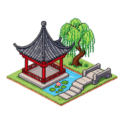</p>

**改编 · 《红楼梦》→ Minecraft** · 6 版<br>
一本小说 → 能走进去的园林<br>
💬 *「把《**红楼梦**》的大观园做进 Minecraft。」*<br>
<a href="https://gameanything-gameanything-demo.static.hf.space/hlm/">▶ 打开演示</a> · <a href="docs/examples/hlm_zh.md">完整对话</a>

<details><summary>读一读对话</summary>

🧑 **我：**（上传《红楼梦》第十七回、第二十七回）

🤖 **Agent：** 22 场戏、23 个地点、22 个人物，189 处引文都和公有领域原文逐字核对过。书里写了*有什么*，几乎从不写多大、屋顶什么样，这部分要么我来补，要么问你。

🃏 **卡片 — 原文没写的 5 件事** → *「要宏大丰富：很大的园子，满是亭台楼阁。尽量逼真：写我们自己的模组，新方块、新模型。」*

🃏 **卡片 — 宏大的园子拿什么填？** A：自己编 · B：加入书里其他写到园子的回目 → **B**（第十八回、第四十回，后来又加第三、第八回，用来定人物长相）

🃏 **卡片 — 每个地点两张预览图** → 10 个地点我各挑一张。

🎬 **第 1 版** — 园子骨架：12 个地点、水系、59 种自制方块、引文牌子。录像 2:06。

🧑 **我**（0:56）：这是什么？和预览差得很远。（1:15）每个院子都该挂个牌匾写名字。

🎬 **第 2 版** — 新加 9 个地点、山丘、层次分明的树、灰瓦飞檐、牌匾、流水声。录像 4:24。

🃏 **卡片 — 人物和剧情怎么出现？** A：站着说话 · B：走近了自动演一小段，字幕用原文 · C：你扮演宝玉 → **B**

🧑 **我**（看剧情预览图）：黛玉葬花看起来像拿锤子在砸花。→ 重画成长柄花锄。

🎬 **第 3–4 版** — 25 个人物模型；25 段戏都放在书里发生的地方；可切换的元宵夜。录像 7:53。

🧑 **我**（7:26）：这些人怎么是飘着的？

🎬 **第 5 版** — 自动检查全部 25 场：没有人悬空了。录像 8:17。

🧑 **我**（4:52）：怎么有个粉色方块挂在空中？黛玉的花锄拿反了，花冢也很粗糙。

🎬 **第 6 版** — 只打磨：圆圆的长满青苔的花冢、花锄朝下、更华丽的正殿。评审：25 个镜头里 16 个接近预览。录像 8:09。

</details>

</td>
</tr>
<tr>
<td width="50%" valign="top" align="left">

<p align="center"></p>

**新功能 · 香港美食 → 胡闹厨房 2** · 4 版<br>
一个想法 → 新的厨房和真的菜<br>
💬 *「在胡闹厨房里开一间**港式茶餐厅**。」*<br>
<a href="https://gameanything-gameanything-demo.static.hf.space/hk/">▶ 打开演示</a> · <a href="docs/examples/hk_zh.md">完整对话</a>

<details><summary>读一读对话</summary>

🧑 **我：**（上传我的美食照片）帮我挑出游戏里没有的经典港式菜，做一张香港地图，再加两个有香港特色的厨师。

🤖 **Agent：** 认出了虾饺、肠粉、菠萝包、煲仔饭、餐蛋治、杨枝甘露……你说的那只卡通小猪有版权，我们做一个原创的粉色小猪厨师和一个通用的功夫厨师。

🃏 **卡片 — 厨师和地图** → 功夫厨师 + 小猪厨师，茶餐厅内景。菜单：7 道菜。

🎬 **第 1 版** — 茶餐厅，四段客流高峰。照实说：做法还是游戏原来的菜谱。录像 2:10。

🧑 **我：** 感觉你就是在原来的菜上换了个图片。为什么煲仔饭是蒸一条鱼？菠萝包是蒸胡萝卜？

🤖 **Agent：** 你说得对。第 2 版每道菜按真实做法，有自己的步骤和食材。

🧑 **我：** 菠萝包要用烤箱啊！

🎬 **第 2 版** — 8 道菜都按真实做法（菠萝包走 搅拌机 → 烤盘 → 借来的烤箱），绿瓷砖墙配大红灯笼的茶餐厅。录像 2:54。

🧑 **我：** 菜都做成 3D，先给我看预览。文字中英双语。录像从关卡第一秒开始。

🃏 **卡片 — 7 个 3D 菜品：保留 / 重做 / 不要** → *「这是俯视吗？？？」「冰块看起来好丑」* 重做两次后：全部保留。

🎬 **第 3 版** — 3D 菜品上盘、双语菜单、新关卡标题。录像 9:41。

🧑 **我**（0:52）：这个粉色的东西是什么？（4:06）煎完蛋把锅拿起来，锅怎么空了？

🎬 **第 4 版** — 面包颜色正常、锅里的煎蛋看得见、装盘位置不再被倒计时挡住。录像 10:11。

</details>

</td>
<td width="50%" valign="top" align="left">

<p align="center"></p>

**玩法 · 读博 → 杀戮尖塔** · 4 版<br>
一段经历 → 游戏自己的机制<br>
💬 *「给杀戮尖塔做一个**读博通关**的角色。」*<br>
<a href="https://gameanything-gameanything-demo.static.hf.space/phd/">▶ 打开演示</a> · <a href="docs/examples/phd_zh.md">完整对话</a>

<details><summary>读一读对话</summary>

🧑 **我：**（上传我写的读博设计笔记）

🤖 **Agent：** 核心张力是：长期投入 vs 不确定的反馈。失败的实验也在攒理解，但只有走完 想法 → 实验 → 证据 → 写作 → 投稿 才能兑现。

🃏 **卡片 — 6 个问题** → 最难熬：被拒稿、很久没进展、打低分的 AI 审稿人。圈内梗：Reviewer 2、arXiv 撞车、token 额度又用完了。

🃏 **卡片 — 机制映射页** → 23 条「经历 → 机制」全保留（失败的实验给 Insight；被拒保留一半进度；敌人是 Bug、Scope Creep 这样的事，从不是人）。

🎬 **第 1 版** — 角色 *The Researcher*：33 张卡、10 个遗物、6 种敌人、Boss *The Deadline*、「You graduated!」结局。录像 3:48。

🧑 **我：** 这个视频就是一张张卡牌在打，没有故事也没有策略。你自己看看。

🎬 **讲解版录像** — 放慢节奏，每个关键决策一行字幕，从「发现问题」到「毕业」分章。录像 3:20。

🧑 **我：** 说实话，设计本身太无聊了。

🃏 **卡片 — 最无聊的是哪几点？** → 感受不到读博、敌人没特点、卡牌太像。**方向：** 真正的两难 + 有记忆点的大招。

🃏 **卡片 — 第二版改动清单（按我的设计）** → 一局就是一次投稿：截稿 → *Under Review* → 三位审稿人打分 → 3 回合 Rebuttal → Accept / Reject & Resubmit / Desk Reject。

🎬 **第 2 版** — 完整的投稿流程；模拟中 41% 的局被接收。录像 3:52。

🧑 **我：** NeurIPS 是 6 分制，你的分数打得不对。

🎬 **第 3–4 版** — 改成 6 分制，卡牌放大，受击和 Stress 有反馈和音效；再改成英文字幕、修好排版。录像 3:55。

</details>

</td>
</tr>
</table>

## 安装

**需要准备的**

| 是什么 | 说明 |
|---|---|
| **Python 3.10-3.14** 和 **[uv](https://docs.astral.sh/uv/)** | 用来运行 `gameanything` 命令 |
| PATH 里有 **ffmpeg** / **ffprobe** | 抽视频帧、做试玩录像 |
| **一个编程 agent** | 下面表格里任选一个 |
| **你自己的正版游戏** | GameAnything 不附带也不下载游戏 |
| **游戏的 mod 加载器** | SMAPI · Fabric · BepInEx · ModTheSpire + BaseMod · tModLoader；其余游戏自带 mod 支持。`gameanything native doctor` 会检查，并告诉你要装什么 |
| **游戏的构建工具** | .NET SDK 6 / 8（星露谷、城市：天际线、胡闹厨房 2、英灵神殿、坎巴拉、泰拉瑞亚）· Java 21 / 11（Minecraft、杀戮尖塔）· Python 3.7（模拟人生 4）· 不需要（文明 6） |

构建可以在你自己的 Windows / macOS / Linux 电脑上、在你自己的游戏里**本机**跑，也可以在**沙箱**里跑：你自己的 Linux 电脑或服务器上的 Docker 容器（3D 游戏要 NVIDIA 显卡），自带 mod 加载器、构建工具和一个在浏览器里看的画面。游戏由你提供：你自己的游戏文件夹，或者在沙箱里用你自己的 Steam / EA / Microsoft 账号下载。所以上表里构建工具和加载器两行只是本机模式需要。怎么装：[docs/install.md](docs/install.md#sandbox-on-your-own-linux-machine-docker) · 镜像：[docs/sandbox-images.md](docs/sandbox-images.md)。

**两个可选功能**体积大，基础安装里没有。不用提前装：素材用得到时，agent 会发卡片问你（干什么用、多大），你同意才装。

| 功能 | 做什么 | 不装会怎样 | 大小 |
|---|---|---|---|
| **语音转文字**（`transcribe`） | 在你的电脑上把视频里说的话转成文字 | 视频照样导入，只是不知道里面说了什么 | 约 150 MB，第一次用时再下载约 1.6 GB 的语音模型 |
| **照片里自动框出人**（`detect`） | 在人物页上先把每个人框好，在你的电脑上找（不识别是谁） | 你自己框人 | 几百 MB 到 2 GB 多 |

想自己装：`gameanything extras status` 会列出缺哪个，以及要运行的命令。

**1. `gameanything` 命令行**（所有 agent 都需要）：

```bash
uv tool install git+https://github.com/AetherLabsAI/GameAnything
```

**2. agent 这一侧**（`gameanything` skill 和说明文件）：

| Agent | 安装 |
|---|---|
| Claude Code | `/plugin marketplace add AetherLabsAI/GameAnything`，然后 `/plugin install gameanything@gameanything` |
| Codex | `codex plugin marketplace add AetherLabsAI/GameAnything`，然后 `codex plugin add gameanything@gameanything` |
| Gemini CLI | `gemini extensions install https://github.com/AetherLabsAI/GameAnything` |
| VS Code / Copilot | 打开 `chat.plugins.enabled`，运行 **Chat: Install Plugin From Source**，填这个仓库的地址 |
| Cursor | Cursor Marketplace → Import from Repo，或者直接打开克隆下来的仓库 |
| OpenCode | 克隆仓库，在里面运行 `opencode`（[插件](plugins/opencode/README.md)） |
| DeepSeek Harness（`dsh`） | 克隆仓库，运行 `dsh web`，用 **Add workspace** 把克隆的文件夹加进去（它会读 `AGENTS.md` 和 `.agents/skills`）；当后台 agent 用：见[设置说明](docs/agent-providers.md#deepseek-harness-setup)（英文） |
| 任何 agent（只装 skill） | `npx skills add https://github.com/AetherLabsAI/GameAnything` |

**3. 启动：**

```bash
gameanything ui        # 打开本地网页
```

然后告诉你的 agent 想做什么（见[例子](#例子)）。

更多：可选组件、只有 API key 怎么用、在克隆的仓库里运行、不通过 agent 直接用命令行：[docs/install.md](docs/install.md)（英文）。

**`gameanything` 命令行**（Python）。每个命令都有带例子的 `--help`。

<!-- fixed widths and no-break spaces keep the icons from shrinking in an auto-width table -->
<table>
  <thead><tr><th width="56">&nbsp;&nbsp;&nbsp;&nbsp;&nbsp;&nbsp;&nbsp;&nbsp;</th><th width="110">命令</th><th>做什么</th></tr></thead>
  <tbody>
    <tr><td align="center"></td><td><code>ui</code></td><td>打开网页：项目、对话、卡片、试玩录像</td></tr>
    <tr><td align="center"></td><td><code>project</code></td><td>新建项目、列表、设置、对话 / 构建模型、导出导入</td></tr>
    <tr><td align="center"></td><td><code>ingest</code></td><td>在本机整理你的照片、视频和文字，不调用模型</td></tr>
    <tr><td align="center">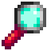</td><td><code>perceive</code></td><td>用模型看懂你的素材，你在卡片上同意后才发送</td></tr>
    <tr><td align="center"></td><td><code>flow</code></td><td>项目做到哪一步、这一步还差什么</td></tr>
    <tr><td align="center"></td><td><code>chat</code></td><td>agent 在网页里和你说话：文字、卡片、进度</td></tr>
    <tr><td align="center"></td><td><code>estimate</code></td><td>构建要多久、花多少钱，开工前就给你看</td></tr>
    <tr><td align="center">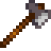</td><td><code>build</code></td><td>后台构建：进度、交付检查、交还构建</td></tr>
    <tr><td align="center">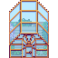</td><td><code>lab</code></td><td>Linux 服务器沙箱：占一个座位、准备环境、在里面登录你自己的 Steam / Microsoft / EA 账号</td></tr>
    <tr><td align="center">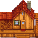</td><td><code>native</code></td><td>你自己的游戏：检查、备份、安装、启动、还原</td></tr>
    <tr><td align="center"></td><td><code>game</code></td><td>支持的游戏；新建并检查一个游戏包</td></tr>
    <tr><td align="center">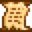</td><td><code>feedback</code></td><td>你的意见记成记录，在同一个画面复查</td></tr>
    <tr><td align="center"></td><td><code>profile</code></td><td>你的偏好，只属于你：查看、修改、关闭</td></tr>
    <tr><td align="center"></td><td><code>lessons</code></td><td>agent 按游戏、按角色积累的经验</td></tr>
    <tr><td align="center"></td><td><code>gen</code></td><td>付费生成预览图和 3D 模型，你在卡片上同意后才做</td></tr>
    <tr><td align="center"></td><td><code>backup</code></td><td>可选的备份：一个文件夹或私有的 Hugging Face 数据集</td></tr>
    <tr><td align="center"></td><td><code>hub</code></td><td>一台服务器给多人用，每人有自己的项目</td></tr>
  </tbody>
</table>

## 账号和花费

| Agent | 账号 | 在 GameAnything 里 |
|---|---|---|
| **Claude Code** | Claude 订阅或 Anthropic API key | 聊天和后台构建（测得最多） |
| **Codex** | ChatGPT 订阅或 OpenAI API key | 聊天和后台构建 |
| **Gemini CLI** | Google 账号或 Gemini API key | 聊天和后台构建 |
| **OpenCode** | 75 家以上的模型服务任选：OpenRouter、Anthropic、OpenAI、本地模型… | 聊天和后台构建 |
| **DeepSeek Harness**（`dsh`） | DeepSeek 或 OpenRouter 的 API key | 聊天；构建已接好，还没测过（见[设置说明](docs/agent-providers.md#deepseek-harness-setup)，英文） |
| **Cursor**、**GitHub Copilot** | 编辑器自己的套餐 | 同一套 skill，交互式使用 |

API key 按 token 计费。

- **每个项目单独选模型**：在输入框旁边的「对话」「构建」里选。Fable 最强，也贵得多。
- **你同意之前不花钱**：开工卡上写着构建模型、预计用时和花费；付费生成图片和 3D 模型另有一张卡要你同意。

**图片、3D 模型和声音（可选）。** 游戏里没有的素材，agent 可以生成。每个服务要单独的 key（在网页上填，或者设成环境变量）；每次付费调用都要你先在卡片上同意，卡片上写着价格。不填的话，构建就只用游戏自带的素材。

| 服务 | Key | 用来做什么 |
|---|---|---|
| **OpenRouter**（Seedream） | `OPENROUTER_API_KEY` | 预览图、目标图、人物头像、图标 |
| **Meshy** | `MESHY_API_KEY` | 3D 模型：地标、道具、人物 |
| **fal** | `FAL_KEY` | 图片、3D、音效、音乐、配音、视频 |
| **OpenAI** | `OPENAI_API_KEY` | 图片（gpt-image） |

## 支持的游戏

<table>
  <thead><tr><th></th><th>游戏</th><th>mod 加载器</th><th align="center">Linux</th><th align="center">macOS</th><th align="center">Windows</th><th align="center">Linux 服务器沙箱</th></tr></thead>
  <tbody>
    <tr><td></td><td><b>星露谷物语</b></td><td>SMAPI</td><td align="center">✅</td><td align="center">✅</td><td align="center">✅</td><td align="center">✅</td></tr>
    <tr><td>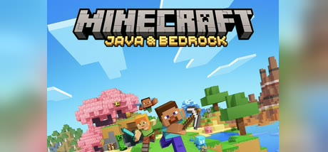</td><td><b>Minecraft</b></td><td>Fabric</td><td align="center">✅</td><td align="center">✅</td><td align="center">✅</td><td align="center">✅</td></tr>
    <tr><td></td><td><b>城市：天际线</b></td><td>自带</td><td align="center">✅</td><td align="center">✅</td><td align="center">✅</td><td align="center">✅</td></tr>
    <tr><td></td><td><b>杀戮尖塔</b></td><td>ModTheSpire + BaseMod</td><td align="center">✅</td><td align="center">✅</td><td align="center">✅</td><td align="center">✅</td></tr>
    <tr><td></td><td><b>胡闹厨房 2</b></td><td>BepInEx 5</td><td align="center">✅</td><td align="center">✅</td><td align="center">✅</td><td align="center">✅</td></tr>
    <tr><td></td><td><b>模拟人生 4</b></td><td>自带</td><td align="center">✅</td><td align="center">✅</td><td align="center">✅</td><td align="center">✅</td></tr>
    <tr><td></td><td><b>英灵神殿</b></td><td>BepInEx 5</td><td align="center">✅</td><td align="center">✅</td><td align="center">✅</td><td align="center">✅</td></tr>
    <tr><td></td><td><b>坎巴拉太空计划</b></td><td>自带</td><td align="center">✅</td><td align="center">✅</td><td align="center">✅</td><td align="center">✅</td></tr>
    <tr><td></td><td><b>泰拉瑞亚</b></td><td>tModLoader</td><td align="center">✅</td><td align="center">✅</td><td align="center">✅</td><td align="center">✅</td></tr>
    <tr><td></td><td><b>文明 6</b></td><td>自带</td><td align="center">✅</td><td align="center">✅</td><td align="center">✅</td><td align="center">✅</td></tr>
    <tr><td align="center">➕</td><td colspan="6"><b>更多游戏接入中。</b>我们正在接入更多游戏。没有你喜欢的？<a href="#接入你自己的游戏">欢迎提 PR 把它加进来</a>。</td></tr>
  </tbody>
</table>

每个游戏的细节（文件夹、加载器、在哪里测过）：[docs/games.md](docs/games.md)。本机和沙箱构建：见[安装](#安装)。

## 接入你自己的游戏

你喜欢的游戏不在列表里？每个游戏就是一个小包：一个 `game.yaml`，一个可选的适配器，再加一个冒烟测试 mod。

```bash
gameanything game new <id> --title "..." --loader ...
gameanything game check <id> --build
```

指南：[add-a-game](skills/gameanything/references/add-a-game.md) · 提 PR：[CONTRIBUTING.md](CONTRIBUTING.md#adding-a-game)。
agent 还会给每个游戏记一本经验本（哪些做法管用、哪里踩过坑）。<!-- TODO 以后能通过 PR 共享经验本时补上 -->

## 隐私与安全

<table><tr><td><ul><li><b>本地优先</b>：你的文件只读不改，项目放在你自己的数据文件夹里。</li><li><b>不经同意不发送</b>：任何照片或文字发给模型之前，先给你发一张许可卡。每一次把你的内容发出去的请求，都记在项目的隐私账本里。</li><li><b>不替真人编事实</b>：agent 给真人拟的台词都标成草稿，你确认了才算数。</li><li><b>存档有备份</b>：改动之前先备份存档和 mod 文件夹，每次安装都能还原、卸载。</li><li><b>构建在沙箱里</b>：沙箱构建在隔离的 Docker 容器里跑。本机模式下，agent 开你的游戏之前会先问你，也只关它自己开的游戏。</li></ul></td><td width="34%"></td></tr></table>

## 评测基准

[GameAnything-Bench](https://github.com/AetherLabsAI/GameAnything-Bench) 是同一篇论文的评测基准：14 款游戏上的 125 个 Construction（构建）任务和 80 个 Editing（编辑）任务。项目主页：[huggingface.co/spaces/GameAnything/GameAnything](https://huggingface.co/spaces/GameAnything/GameAnything)。

## 常见问题

**要会写代码吗？** 不用。你只要聊天和点选，代码由 agent 来写。

**会附带游戏吗？** 不会。你需要自己的正版游戏，GameAnything 只是往里面加一个 mod。

**用哪个 agent 好？** 用你已经有的就行：Claude Code、Codex、Gemini CLI、OpenCode 都能在后台全自动聊天和构建（Claude Code 测得最多）；DeepSeek Harness 能聊天，构建还没测过；Cursor、Copilot 可以交互式使用。每个项目的「对话」和「构建」模型都能在输入框旁边单独选。

## 🤝 参与贡献

GameAnything 是一个开放的项目，我们热烈欢迎玩家、游戏设计师、mod 作者和研究者参与贡献。有两种参与方式：

| | [**试用 GameAnything**](https://huggingface.co/spaces/GameAnything/GameAnything-Trial) | [**贡献任务**](https://huggingface.co/spaces/GameAnything/gameanything-submit) |
|---|---|---|
| **适合** | 想用这个平台的任何人 | 有游戏点子、也有参考素材的任何人 |
| **你分享** | 你玩的游戏、你做过的 mod，以及一个你想做出来的点子（约 3 分钟） | 一份参考素材、一款目标游戏、一个需求和评分要点（约 10 分钟，不用写代码） |
| **你得到** | 入选后可免费试用 | 在论文中署名致谢：5 个任务被采纳即在致谢中列出你的名字；一个完整的游戏任务包外加 10 个被采纳的任务即可成为作者 |

被采纳的任务会以 CC BY 4.0 协议、用你选择的署名加入公开发布的评测基准。提交页面有完整的示例，论文附录 *Call for Contributions* 列出了具体标准。

也欢迎贡献代码：新的 agent、新的游戏和修复，都可以向 [GameAnything](https://github.com/AetherLabsAI/GameAnything) 或 [GameAnything-Bench](https://github.com/AetherLabsAI/GameAnything-Bench) 提 PR。有问题请提 issue，或发邮件到 [wew058@ucsd.edu](mailto:wew058@ucsd.edu)。

## 引用

如果 GameAnything 对你有帮助，请引用我们的[论文](https://arxiv.org/abs/2611.29238)：

```bibtex
@misc{wu2026gameanything,
  title  = {GameAnything: From Any Inspirations to Playable Game Worlds},
  author = {Wenyi Wu and Siqi Liu and Yuru Feng and Zixuan Song and Aayush Salvi and
            Sibo Zhu and Kun Zhou and Biwei Huang},
  year   = {2026},
  eprint = {2611.29238},
  archivePrefix = {arXiv},
  primaryClass  = {cs.AI},
  url    = {https://arxiv.org/abs/2611.29238}
}
```

## 许可证

采用 [Apache License 2.0](LICENSE) 许可证。

命令表里的图标来自 Stardew Valley，© ConcernedApe，仅作展示，不在 Apache-2.0 许可证范围内（[详情](docs/media/icons/cli/NOTICE.md)）。

**商标和你自己做的 mod。** GameAnything 与这里列出的任何游戏的开发商都没有关联，也没有得到它们的认可。游戏名称、标志和头图归各自所有者。
例子里用了知名的小说和电影，只是为了展示能做什么：用别人的作品做出来的 mod 只供你自己玩，没有版权方许可，请不要分享或出售。
